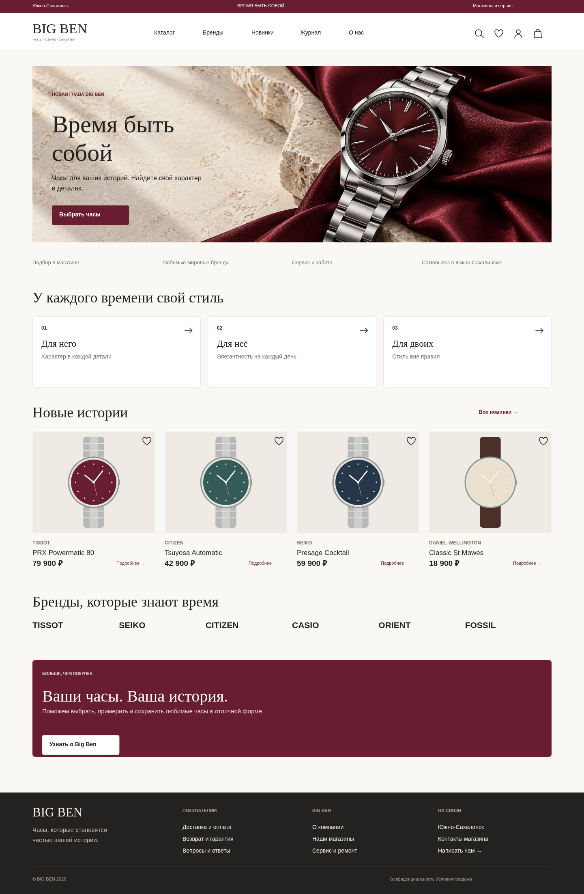

# BIG BEN — концепция нового магазина

## Новый сайт на React

В `website/` находится адаптивный сайт по этим макетам: React + Motion, Node.js / Express и PostgreSQL. Работают каталог, поиск, фильтры, избранное, сравнение, корзина и оформление учебных заказов.

- [Готовый сайт для просмотра без установки](website/preview/index.html): скачайте файл кнопкой **Download raw file**, затем откройте сохранённый HTML в браузере. Все изображения и код встроены; данные в этой версии сохраняются в браузере.
- [Скриншот компьютера](website/preview/home-desktop.png) · [Скриншот телефона](website/preview/home-mobile.png).
- [Архив сайта и исходников](website/preview/bigben-site-source.zip).
- [Запуск серверной версии с PostgreSQL и инструкции разработки](website/README.md).

Это демоверсия: настоящие платежи, авторизация, резервирование товара и доставка ещё не подключены. Ниже — исходный комплект дизайн-макетов.

42 типа страниц, 84 экрана: Desktop 1440 px и Mobile 390 px. Светлая редакционная стилистика, бордовый акцент, крупные заголовки, спокойная сетка и выразительный первый экран.

[Скачать полный комплект ZIP](https://github.com/Ivan9812/bigben65/archive/refs/heads/main.zip)

## Превью главной

## Посмотреть

Откройте `index.html` в браузере. Слева — все страницы; сверху — выбор компьютера/телефона и обзор всей коллекции. Можно скачать SVG отдельного экрана. Просмотрщик работает локально без сервера и внешних библиотек; если браузер запрещает локальные ресурсы, запустите `python -m http.server 8080` в этой папке.

PNG: `home-desktop.png`, `home-mobile.png`, `product-desktop.png`, `checkout-mobile.png`. SVG всех экранов — в `screens/`. Исходная структура слоёв — `design.json`; цвета и размеры — `tokens.json`.

## Создать редактируемый файл Figma

1. Распакуйте архив на компьютере. Откройте **Figma Desktop** и новый дизайн-файл.
2. В меню **Plugins → Development → Import plugin from manifest** выберите `figma-plugin/manifest.json`.
3. Запустите **BIG BEN Design Import**, выберите устройства и нажмите «Создать экраны».
4. Появятся две страницы Figma: «BIG BEN • Макеты» и «BIG BEN • Дизайн-система». Экраны состоят из настоящих Frame, Text, Rectangle и Vector; их можно редактировать. Плагин работает без сети, создаёт отдельные страницы и не заменяет существующие макеты.
5. **File → Save local copy** сохраняет полученный файл в `.fig`.

Сам архив не содержит готового бинарного `.fig`. Его создаёт Figma после импорта. Плагин подготовлен и проверен по структуре/API на изолированной модели; запуск в настоящем приложении Figma в этой среде недоступен. Экраны имеют фиксированную геометрию для двух контрольных ширин, а не Auto Layout. Изображение кампании растровое; остальные иллюстрации — векторные. Для редактируемого текста используйте плагин, поскольку поведение импорта SVG-текста зависит от Figma. Шрифты: Inter, Playfair Display; при недоступном Playfair Display плагин использует Inter. В браузерных SVG допускаются системные резервные шрифты.

## Состав страниц

Главная; каталог; мужские, женские и унисекс-часы; бренды; коллекция бренда; карточка товара; поиск; избранное; сравнение; корзина; оформление; успешный заказ; вход; регистрация; восстановление доступа; кабинет; профиль; список и детали заказов; адреса; бонусы; магазины; страница магазина; сервис; заявка в сервис; доставка; оплата; возврат; гарантия; о компании; журнал; статья; контакты; FAQ; конфиденциальность; условия продажи; согласие; 404; пустая корзина; состояния интерфейса.

`pages.md` содержит карту маршрутов. `HANDOFF.md` — рекомендации по адаптивности, состояниям и анимациям для разработки на React.

## Важные границы концепции

Сайт https://www.bigben65.ru/ и вариант без www отвечали 403 в используемой среде. Поэтому текущую карту страниц, ассортимент, контакты и точную идентичность бренда проверить не удалось. Этот комплект охватывает перечисленные 42 типа страниц нового интернет-магазина, но не является подтверждённой копией всех URL действующего сайта.

Цены, модели, профиль пользователя, заказ и бонусный баланс — демонстрационные. Векторные изображения часов не являются фотографиями указанных моделей. Кампания с бордовыми часами создана специально для концепции и не представляет реальный товар. Карта магазинов схематическая. Текстовый знак BIG BEN — предложение для макета, а не изменение зарегистрированного логотипа. Перед реализацией замените данные, логотип, фотографии товаров, адреса и правовые тексты актуальными материалами магазина. Подключение платежей, лояльности и аккаунтов не выполнено: это комплект дизайна, а не действующий магазин.

## Проверки

84 SVG открыты в Chromium; текст не выходит за ширину экранов. Проверены переключение устройств, список из 42 страниц, обзор макетов и инструкция Figma; исключений JavaScript нет. PNG-превью получены из реального рендеринга экранов. JS плагина проходит синтаксическую проверку; тест модели API создаёт 85 фреймов и более 5 000 редактируемых узлов. Это не заменяет тест в реальном Figma.

## Повторная генерация

Python 3, без дополнительных пакетов: `python build.py`, затем `python make-preview.py` и `python make-plugin.py`. Изображение кампании берётся из `assets/hero.png`. Эти команды пересобирают SVG, JSON, просмотрщик и плагин; PNG-превью получены отдельно в Chromium.
